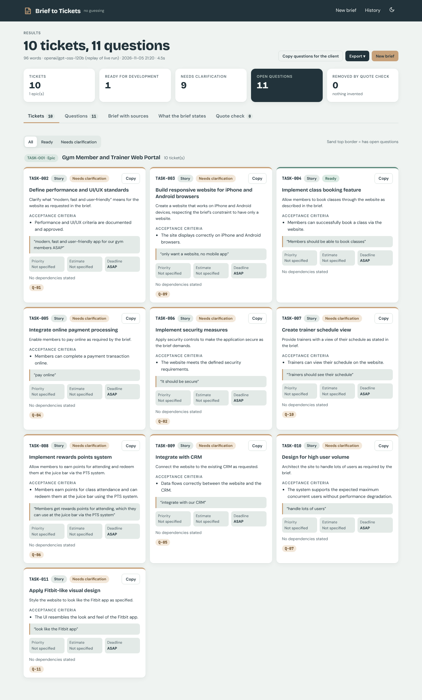
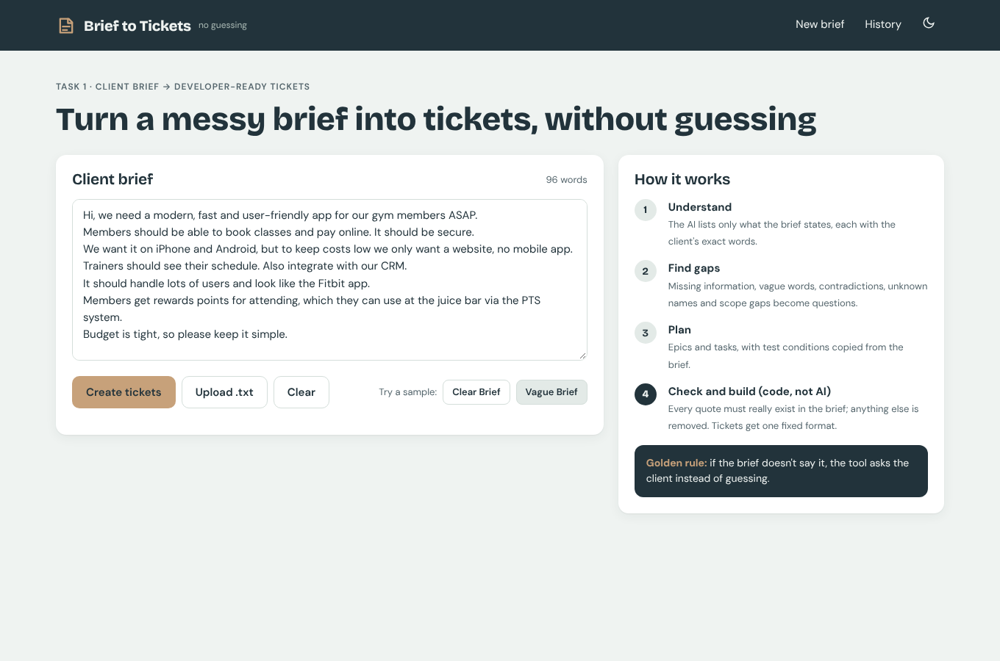
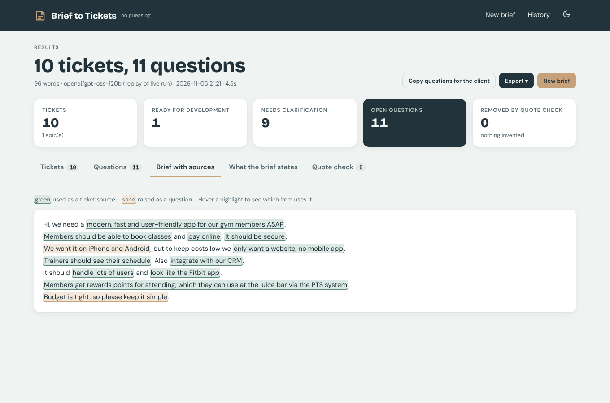
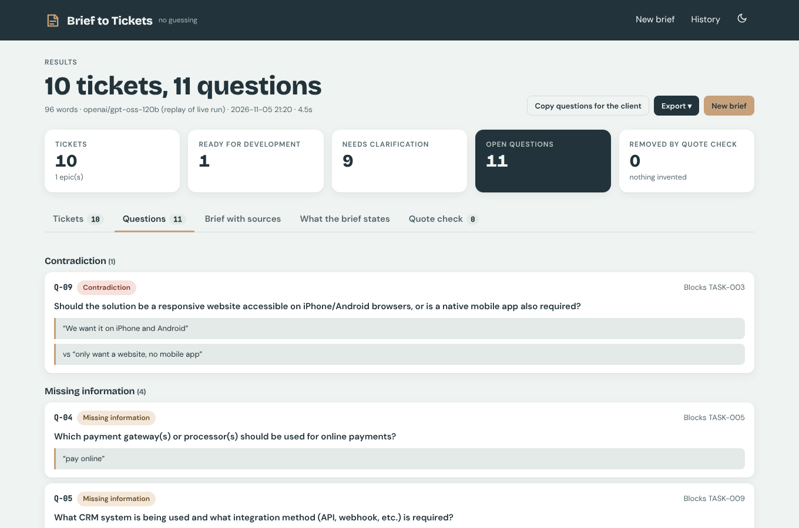

# Brief to Tickets: Client Brief → Dev-Ready Jira Tickets

```
pip install requests
python brief_to_tickets.py briefs/clear_brief.txt
python brief_to_tickets.py briefs/vague_brief.txt
```
Needs a `.env` with `LLM_API_KEY`, `LLM_BASE_URL`, `LLM_MODEL` (Groq: `https://api.groq.com/openai/v1`, `openai/gpt-oss-120b`).
Keys are read from the environment only, never printed or saved.
Output: on screen, plus `output/<brief>.md`, `output/<brief>_tickets.csv` (Jira CSV import) and `output/<brief>_tickets.json`.

**Libraries:** Python 3 standard library + `requests` (and `flask` for the web app).

## Web app

```
pip install -r requirements.txt
cp .env.example .env      # add your LLM key
python web.py             # open http://localhost:8100
```

Paste or drop a brief, watch the 4 stages run, then browse tickets by epic, the questions for the client,
and the brief with every ticket's source quote highlighted. Export Jira CSV / JSON / Markdown.



| New brief | Brief with sources | Client questions |
|---|---|---|
|  |  |  |

## Stages (one focused prompt each, chained; output checked in code before the next stage)
1. **Understand:** goals, features, users, constraints, integrations, deadlines, priorities, each with a word-for-word quote.
2. **Detect gaps:** missing info, vague wording, contradictions (both quotes), undefined terms, scope gaps → client questions.
3. **Break down:** epics → tasks, with acceptance criteria quoted from the brief and dependencies only when the brief states them.
4. **Tickets:** built by code, not the AI: IDs `TASK-001…`, fixed fields, "Not specified" defaults, questions attached,
   status *Needs clarification* or *Ready for development*.

## How it avoids assumptions
* Every prompt contains the golden rule: use only the brief, quote it word for word, write "Not specified" otherwise.
* **Check, do not trust:** code verifies that every quote really appears in the brief. Unsupported facts, questions,
  tasks, criteria and epics are removed and listed under "Removed by the verification step".
* Priority, estimate and deadline are kept only when backed by a quote; dependencies only when the brief states them.
* A contradiction is kept only if both quoted sentences exist.
* A task with no acceptance criteria in the brief is marked *Needs clarification*.
* Invalid JSON from the AI is rejected and asked again once; then the tool stops with a clear message instead of guessing.

## Demo briefs
* `briefs/clear_brief.txt`: reasonably clear (bakery pre-orders)
* `briefs/vague_brief.txt`: deliberately vague and contradictory (gym app: "iPhone and Android" vs "only a website",
  "fast", "secure", "PTS system", "CRM")

## Tests
The offline check (in the chat) feeds the pipeline a scripted fake AI that invents a feature, a criterion, an epic,
a priority and a contradiction quote, and returns broken JSON once. All invented items were removed and the retry worked.

## Demo results (real LLM: Groq openai/gpt-oss-120b)
* `output/vague.md` + `vague_tickets.csv/json`: 11 tickets, 11 open questions. The contradiction ("iPhone and Android" vs
  "only want a website, no mobile app"), the vague words (fast, secure, Fitbit-like, lots of users), the undefined "PTS system",
  and the missing CRM / payment gateway / real deadline were all flagged.
* `output/clear.md` + `clear_tickets.csv/json`: 8 tickets, 8 open questions. Priority "Highest" only on ordering (stated in the brief);
  one dependency (staff order list → ordering), stated in the brief; no payment provider invented (the brief says cash on pickup).
* A Groq rate-limit error (HTTP 429, 8,000 tokens/minute free tier) occurred on the second run; it was re-run after 60 s.

## Known issues found in review (not fixed due to time)
1. A ticket title can lean to one side of a flagged contradiction (TASK-003 assumed "website only"); it is still marked Needs clarification (Q-09).
2. A vague deadline ("ASAP") is copied as the deadline instead of "Not specified" even though Q-08 flags it.
3. Some acceptance criteria are generic wording; the quote check confirms the source exists but not that the criterion is testable.
4. The launch deadline (15 January 2027) was extracted but not placed on the Epic's deadline field.
5. TASK-008's acceptance criterion restates a build-order constraint as a feature condition.
